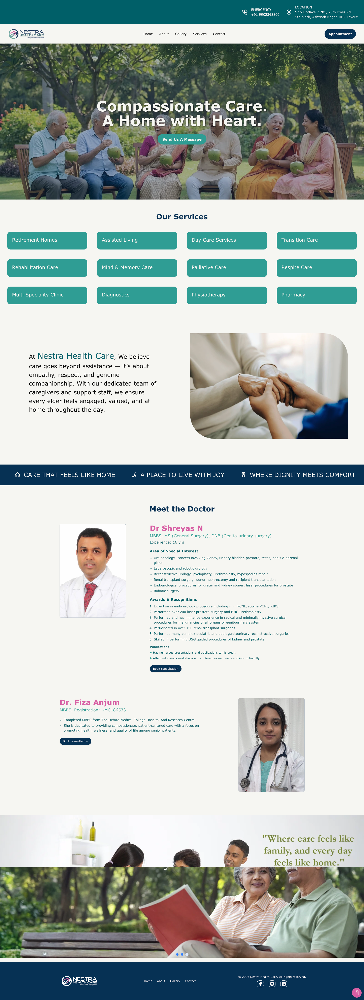
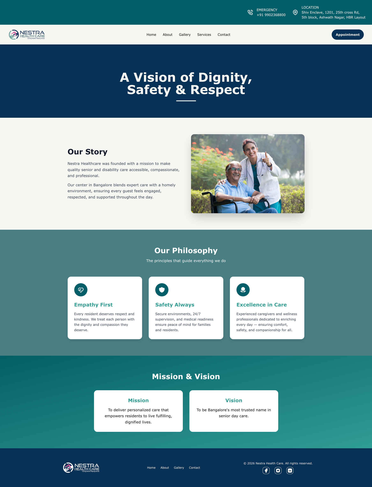
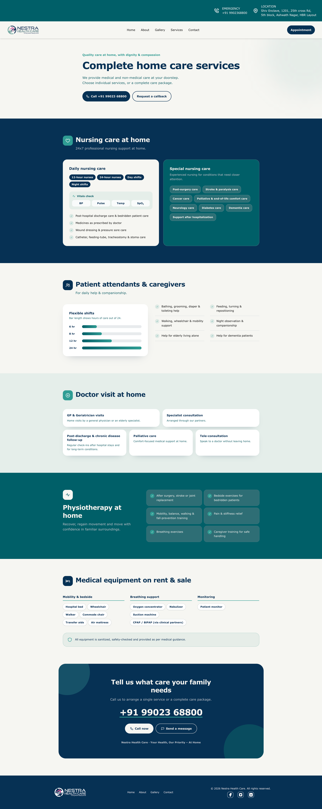
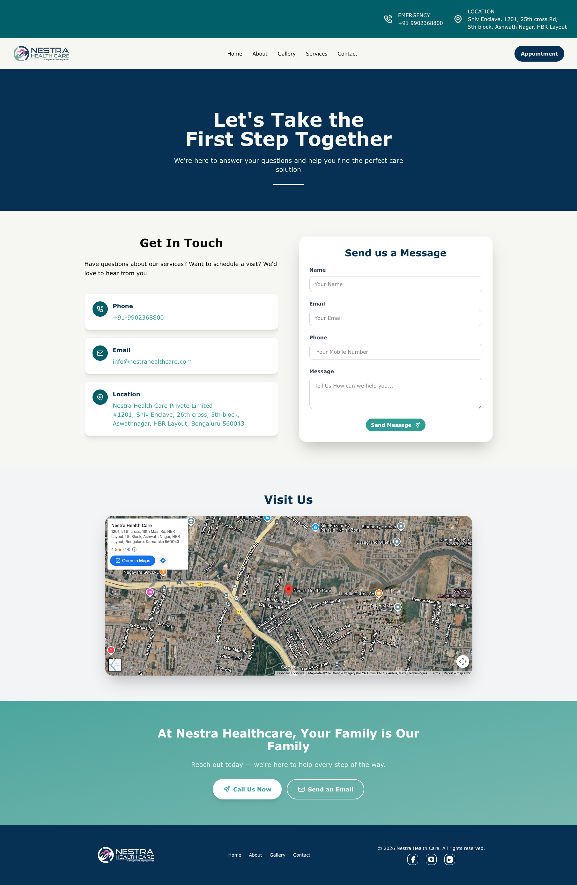

# Nestra Health Care — Compassionate Senior Living & Healthcare 🏥

## 📄 Project Description

**Nestra Health Care** is a modern, responsive healthcare and senior living website built with **Next.js, React, TypeScript, and Tailwind CSS v4**.

The website represents Nestra Health Care, a senior care facility focused on providing compassionate, personalized, and professional care for elderly individuals.

It showcases the organization's healthcare services, senior living facilities, medical professionals, and care solutions through a clean, user-friendly interface.

The platform provides visitors with essential information about available services, the organization's philosophy, healthcare professionals, and contact options, helping families find suitable care solutions for their loved ones.

## ✨ Features

- ⚡ **Modern Next.js Architecture** – Built with Next.js 15 and React 19 for a fast, optimized, and scalable web experience.
- 🎨 **Responsive UI with Tailwind CSS v4** – Fully responsive layouts optimized for mobile, tablet, and desktop devices.
- 🏥 **Healthcare Services Showcase** – Dedicated sections presenting Retirement Homes, Assisted Living, Day Care, Transition Care, Rehabilitation, Mind & Memory Care, and other healthcare services.
- 👨‍⚕️ **Medical Professionals Section** – Displays doctor profiles, qualifications, experience, specializations, and professional information.
- 🏡 **Senior Living Information** – Highlights personalized care, assisted living facilities, safety, wellness, and elderly support services.
- 📩 **Contact & Enquiry Forms** – Provides an accessible way for visitors to submit enquiries and connect with the healthcare team.
- 🎬 **React Fast Marquee** – Used for animated scrolling content and promotional UI elements.
- ✅ **Form Management & Validation** – React Hook Form for handling form state, input management, and validation.
- 🔔 **Toast Notifications** – React Hot Toast for displaying user feedback and notification messages.
- 🖼️ **Iconography** – Tabler Icons and React Icons for consistent and modern visual elements.
- 🔍 **SEO-Friendly Architecture** – Next.js App Router and metadata support for improved search engine visibility.

## 💡 Project Highlights

- **Real-world Client Project** – Developed for a healthcare organization with a focus on senior care and assisted living services.
- **Healthcare-Focused UI/UX** – Clean layouts, accessible navigation, and a user-friendly interface designed to communicate trust, safety, and compassion.
- **Service-Oriented Architecture** – Dedicated content sections for different healthcare and senior living services.
- **Doctor & Medical Information** – Structured presentation of healthcare professionals and their expertise.
- **Responsive Experience** – Optimized browsing experience across different screen sizes and devices.
- **Production-Ready Next.js Application** – Built using modern React and Next.js conventions with TypeScript for maintainability and type safety.
- **Contact & Enquiry Experience** – Simplifies communication between prospective clients, families, and the healthcare organization.

## 🛠 Tech Stack

**Core:**

- [Next.js](https://nextjs.org/) – React framework with App Router.
- [React](https://react.dev/) – Component-based UI development.
- [TypeScript](https://www.typescriptlang.org/) – Static typing and improved code maintainability.
- [Tailwind CSS](https://tailwindcss.com/) – Utility-first CSS framework.

**Forms & Notifications:**

- [react-hook-form](https://react-hook-form.com/) – Form state management and validation.
- [react-hot-toast](https://react-hot-toast.com/) – Toast notifications and user feedback.

**UI Enhancements:**

- [@tabler/icons-react](https://tabler.io/icons) – Modern icon library.
- [react-icons](https://react-icons.github.io/react-icons/) – Icon collection for React applications.
- [react-fast-marquee](https://www.npmjs.com/package/react-fast-marquee) – Animated scrolling and marquee components.

**Development Tools:**

- [ESLint](https://eslint.org/) – Code linting and quality checks.
- [TypeScript](https://www.typescriptlang.org/) – Type checking.
- [PostCSS](https://postcss.org/) – CSS processing.

## 📁 Project Structure (Overview)

```txt
Nestrahealthcare-TS/
│
├── components/          # Reusable UI components
│
├── public/              # Static assets (images, icons, and other media)
│
├── src/
│   └── app/             # Next.js App Router and application pages
│
├── .gitignore           # Git ignored files configuration
├── declaration.d.ts     # Custom TypeScript declarations
├── eslint.config.mjs    # ESLint configuration
├── next.config.ts       # Next.js configuration
├── package.json         # Project dependencies and scripts
├── package-lock.json    # Dependency lock file
├── postcss.config.mjs   # PostCSS configuration
├── tsconfig.json        # TypeScript configuration
└── README.md            # Project documentation
```

## 🚀 Getting Started

### Prerequisites

- Node.js (LTS version recommended)
- npm (Node Package Manager)
- Git

### Installation & Development

**1. Clone the repository**

```bash
git clone https://github.com/Ajoy-paul11/Nestrahealthcare-TS.git
```

**2. Navigate to the project directory**

```bash
cd Nestrahealthcare-TS
```

**3. Install dependencies**

```bash
npm install
```

**4. Start the development server**

```bash
npm run dev
```

Open [http://localhost:3000](http://localhost:3000) in your browser to view the application.

### Build for Production

**Create a production build**

```bash
npm run build
```

**Start the production server**

```bash
npm run start
```

### Run ESLint

```bash
npm run lint
```

## 🌐 Website Pages & Services

The website includes the following sections:

- **Home** – Introduction to Nestra Health Care, featured services, and healthcare information.
- **About** – Organization's story, mission, vision, and care philosophy.
- **Gallery** – Visual presentation of the healthcare facility and its environment.
- **Retirement Homes** – Information about independent senior living and retirement facilities.
- **Assisted Living** – Personalized assistance and daily living support for elderly individuals.
- **Day Care Services** – Senior day care information.
- **Transition Care & Rehabilitation** – Healthcare and recovery support services.
- **Mind & Memory Care** – Specialized elderly care services.
- **Contact** – Contact details, enquiry form, and location information.

Additional services showcased include Palliative Care, Respite Care, Multi-Speciality Clinic, Diagnostics, Physiotherapy, and Pharmacy.

## 📸 Screenshots

| Home Page | About Page |
|:---:|:---:|
|  |  |

| Services Page | Contact Page |
|:---:|:---:|
|  |  |

## 🌐 Live Website

- **Website:** [nestrahealthcare.com](https://nestrahealthcare.com/)
- **GitHub Repository:** [Nestrahealthcare-TS](https://github.com/Ajoy-paul11/Nestrahealthcare-TS)

## 📄 License

#### 1. This project was developed for Nestra Health Care.

#### 2. The source code is available for reference and learning purposes.

#### 3. Commercial reuse of the website's design, content, branding, and assets may be restricted by the client's terms and ownership rights.

## 👨‍💻 Author

**Ajoy Paul — Full-Stack Developer**

- **GitHub:** [@Ajoy-paul11](https://github.com/Ajoy-paul11)
- **Portfolio:** [portfolio-ajoy-paul.vercel.app](https://portfolio-ajoy-paul.vercel.app)
- **LinkedIn:** [Ajoy Paul](https://www.linkedin.com/in/ajoypaul/)
